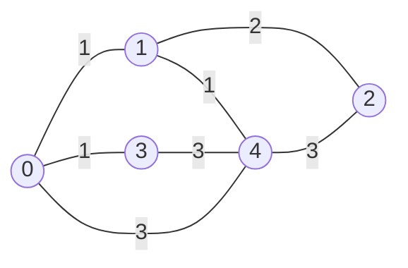

# Recorrido en profundidad (*DFS, Depth-First Search*)

El recorrido en profundidad es un algoritmo fundamental para explorar grafos. Partiendo de un nodo de origen, el algoritmo visita un nodo y luego se mueve inmediatamente a uno de sus vecinos no visitados, y desde ese vecino a otro, profundizando tanto como sea posible antes de retroceder. Cuando un nodo no tiene vecinos sin visitar, el algoritmo regresa al nodo desde el cual se llegó y continúa por otra rama. El resultado es una secuencia de visita que agota una rama completa del grafo antes de pasar a la siguiente.

El término inglés *depth-first search* (DFS) se traduce de dos maneras en la literatura: **búsqueda en profundidad** cuando el algoritmo tiene un objetivo, como encontrar un nodo o un camino, y **recorrido en profundidad** cuando el propósito es visitar todos los nodos alcanzables. La diferencia es de énfasis, no de mecanismo: el mismo algoritmo sirve para ambas cosas. En esta página usaremos **recorrido en profundidad**, porque el programa que presentamos visita el grafo completo desde un origen, sin buscar un nodo específico.

El recorrido en profundidad aparece en varios problemas clásicos. Se usa para **detectar ciclos** en grafos dirigidos, lo que a su vez permite decidir si un conjunto de dependencias puede resolverse en algún orden. También es la base del **ordenamiento topológico**, que se emplea en la planificación de tareas, en los sistemas de construcción de software y en la verificación de prerrequisitos. Finalmente, es el mecanismo subyacente en los algoritmos de **retroceso** (*backtracking*), como la resolución de laberintos, el problema de las ocho reinas o la búsqueda de soluciones en un espacio de restricciones.

---

## Concepto clave: profundizar antes de retroceder

La idea central del recorrido en profundidad es que, en cada nodo, el algoritmo elige un vecino no visitado y se mueve a él de inmediato, sin explorar los demás vecinos primero. Solo cuando el nodo actual no tiene vecinos sin visitar, el algoritmo retrocede al nodo anterior y continúa con el siguiente vecino de ese nodo. Este comportamiento es lo que distingue a DFS del **recorrido en anchura** (*BFS, Breadth-First Search*), que explora el grafo nivel por nivel: DFS agota una rama completa antes de considerar las alternativas.

La recursión implementa este comportamiento de forma natural: cada llamada representa un nodo y cada regreso representa el retroceso al nodo anterior, de modo que la pila de llamadas de Python mantiene implícitamente el camino desde el origen y no hace falta administrar una pila explícita. Esa es la diferencia esencial con BFS: DFS usa una pila (*stack*), mientras que BFS usa una cola (*queue*).

Para que el recorrido termine, es necesario registrar qué nodos ya se visitaron. Sin este registro, el algoritmo volvería a entrar a los nodos ya explorados y, en un grafo con ciclos, no terminaría nunca. En un grafo no dirigido el problema es inmediato: desde un nodo `v` se puede regresar al nodo `u` por la arista inversa que el módulo agrega automáticamente, de modo que sin un conjunto de visitados el recorrido rebotaría indefinidamente entre `u` y `v`. En un grafo dirigido el problema aparece cuando existe un ciclo. En ambos casos la solución es la misma: un conjunto `visited` que registra los nodos ya procesados y que se consulta antes de cada llamada recursiva.

---

## Explicación del programa

### 1. Importación del módulo

El programa comienza importando únicamente la clase `Graph` del módulo `graphs.py`:

```python
from graphs import Graph
```

Esta forma trae un solo nombre al programa, en lugar de todo el contenido del módulo. Basta con importar `Graph` porque es la única clase que el programa instancia directamente: los nodos y las aristas se crean y se manejan a través de los métodos del grafo.

La alternativa sería importar el módulo completo, pero eso obligaría a calificar cada uso con el nombre del módulo. La diferencia entre ambas formas es visible en cómo se instancia el grafo:

```python
# Opción A: from graphs import Graph
from graphs import Graph

g = Graph(5, undirected=True)          # nombre directo
```

```python
# Opción B: import graphs
import graphs

g = graphs.Graph(5, undirected=True)   # hay que calificar con graphs.
```

Con `from graphs import Graph`, el nombre queda disponible sin prefijo. La forma calificada solo es preferible en programas grandes con varios módulos, donde el prefijo aclara de dónde viene cada nombre; aquí no aporta nada.

Para que la importación funcione, `graphs.py` debe estar en el mismo directorio que el programa (o en una ruta incluida en `PYTHONPATH`). El módulo no ejecuta código al importarse, ya que solo define clases, de modo que la importación no produce efectos secundarios.

### 2. Construcción del grafo

El programa comienza instanciando un grafo de cinco nodos y sin dirección:

```python
g: Graph = Graph(5, undirected=True)
g.insert_edge(0, 1, 1.0)
# ...
```

El grafo de trabajo es el caso de prueba de *Graph Algorithms the Fun Way*, que consta de cinco nodos y siete llamadas a `insert_edge`. Su estructura se representa así:



La primera línea crea un grafo con cinco nodos. La anotación `g: Graph` declara el tipo de la variable, y la llamada `Graph(5, undirected=True)` indica que el grafo tiene cinco nodos y que es **no dirigido**. Como se explicó en la página del módulo (la página anterior), un grafo no dirigido agrega cada arista en ambos sentidos: la llamada `insert_edge(0, 1, 1.0)` crea la arista `0 → 1` y también la arista `1 → 0`. Por eso basta con una llamada por par de nodos.

Las llamadas restantes insertan las aristas. Cada llamada a `insert_edge(from_node, to_node, weight)` pasa los dos extremos de la arista y su peso. Para entender cómo se construye la arista, conviene mirar cómo `__init__` crea la lista de nodos:

```python
self.nodes = [Node(j) for j in range(num_nodes)]
```

Esta línea es una comprensión de lista: crea un `Node` por cada valor que produce `range(num_nodes)`. Para `Graph(5)`, `range(5)` produce `0, 1, 2, 3, 4`, y la comprensión equivale a:

```python
self.nodes = [Node(0), Node(1), Node(2), Node(3), Node(4)]
```

La lista contiene cinco objetos `Node`, cada uno con su propio `index`, su propio diccionario `edges` vacío y su propio `label`. Además, la posición en la lista coincide con el índice del nodo: `self.nodes[0].index == 0`, `self.nodes[1].index == 1`, y así sucesivamente. Este invariante es el que permite acceder a un nodo por su número.

Con esa lista en mente, la parte esencial de `insert_edge` es la siguiente:

```python
self.nodes[from_node].add_edge(to_node, weight)   # arista de origen a destino
if self.undirected:
    self.nodes[to_node].add_edge(from_node, weight)  # arista inversa
```

La expresión `self.nodes[from_node]` recupera el nodo cuyo índice es `from_node`, y `.add_edge(to_node, weight)` le pide a ese nodo que construya la arista. El método `add_edge` pertenece a `Node`, no a `Graph`, y es el que crea el objeto `Edge`:

```python
def add_edge(self, neighbor: int, weight: float):
    self.edges[neighbor] = Edge(self.index, neighbor, weight)
```

De este modo, `Graph.insert_edge` no construye aristas por su cuenta: recupera el nodo adecuado de la lista y le delega la tarea. La rama `if self.undirected` repite la operación sobre el nodo de destino, con lo cual se agrega la arista inversa y se produce la simetría de un grafo no dirigido.

El método verifica además que ambos índices estén en el rango `0` a `4` y lanza `IndexError` si alguno no lo está. Esta validación corresponde a `Graph` porque es la clase que conoce el número de nodos.

Al terminar las siete llamadas, cada nodo ha acumulado en su diccionario `edges` las aristas que salen de él. El estado resultante del grafo es el siguiente:

```python
g.nodes[0].edges   # {1: Edge(0, 1, 1.0), 3: Edge(0, 3, 1.0), 4: Edge(0, 4, 3.0)}
g.nodes[1].edges   # {0: Edge(1, 0, 1.0), 2: Edge(1, 2, 2.0), 4: Edge(1, 4, 1.0)}
g.nodes[2].edges   # {1: Edge(2, 1, 2.0), 4: Edge(2, 4, 3.0)}
g.nodes[3].edges   # {0: Edge(3, 0, 1.0), 4: Edge(3, 4, 3.0)}
g.nodes[4].edges   # {0: Edge(4, 0, 3.0), 1: Edge(4, 1, 1.0), 2: Edge(4, 2, 3.0), 3: Edge(4, 3, 3.0)}
```

**Nota:** La notación `Edge(...)` es conceptual; al imprimir el diccionario, Python muestra la representación del objeto.

Cada diccionario asocia el índice de un vecino con el objeto `Edge` correspondiente. Como el grafo es no dirigido, cada arista aparece dos veces en total: una en el diccionario del nodo de origen y otra en el del nodo de destino, con `from_node` y `to_node` intercambiados. El nodo 0, por ejemplo, tiene tres aristas salientes; el nodo 2 tiene dos, porque recibe aristas de 1 y de 4 pero no emite ninguna propia.

Una observación sobre los pesos: este programa **no los utiliza**. El recorrido en profundidad decide a qué nodo moverse basándose únicamente en si existe una arista hacia él, sin consultar su peso. Los pesos aparecen en el código porque `Edge` los almacena y porque el mismo grafo se reutilizará en las páginas de BFS y Dijkstra, donde sí importan. Aquí podrían ser todos `1.0` sin que el resultado del recorrido cambiara.

### 3. La función recursiva

El recorrido en profundidad se implementa en una función recursiva que recibe el grafo, el nodo actual, el conjunto de nodos visitados y la lista donde se acumula el orden de visita:

```python
def dfs(graph: Graph, node: int, visited: set, order: list) -> None:
    visited.add(node)
    order.append(node)
    for edge in graph.nodes[node].get_sorted_edge_list():
        if edge.to_node not in visited:
            dfs(graph, edge.to_node, visited, order)
```

#### Estructura LIFO (*last in, first out*)

La función visita los nodos en profundidad gracias a la pila de llamadas de Python, una estructura LIFO (*last in, first out*) que el intérprete mantiene y que no aparece en el código fuente explicítamente. Es decir, la recursión *es* la pila, y lo que ocurre en cada llamada recursiva se puede describir en tres pasos:

1. **Suspender la llamada actual.** Python guarda sus variables locales (el nodo actual, la posición dentro del ciclo `for`, etc.) para poder volver a ellas después.
2. **Apilar un nuevo marco.** La nueva llamada entra en la pila de llamadas con sus propios valores.
3. **Desapilar al regresar.** Cuando la llamada interna termina, Python la saca de la pila y reanuda la llamada suspendida exactamente donde se quedó.

Ese orden es exactamente lo que produce el comportamiento de profundidad, pues el algoritmo explora una rama completa antes de regresar a los nodos anteriores. El recorrido en anchura que se presenta en la página siguiente usa una cola (FIFO, *first in, first out*), que produce el comportamiento opuesto: explora por niveles porque retoma primero el nodo que llegó antes.

---

{: .tip-circle }

**La pila en la versión iterativa**

La pila que es tan importante al funcionalmiento del DFS no aparece en el código porque Python la administra al llamar a la función. Para verla explícitamente, la misma lógica se puede escribir de forma iterativa con una pila:

```python
def dfs_iterative(graph: Graph, start: int, visited: set, order: list) -> None:
    stack = [start]
    while stack:
        node = stack.pop()              # saca el último en entrar: LIFO
        if node in visited:
            continue
        visited.add(node)
        order.append(node)
        for edge in reversed(graph.nodes[node].get_sorted_edge_list()):
            if edge.to_node not in visited:
                stack.append(edge.to_node)
```

La lista `stack` cumple el papel que en la versión recursiva cumple la pila de llamadas. El método `pop()` sin argumentos extrae el **último** elemento de la lista, que es exactamente el comportamiento LIFO: el nodo que se agregó más recientemente es el siguiente en procesarse. Por eso el recorrido profundiza en lugar de avanzar por niveles.

El `reversed(...)` en la versión iterativa es un detalle de fidelidad. Como `stack.pop()` extrae el último elemento, para que los vecinos se procesen en orden ascendente hay que apilarlos en orden descendente. La versión recursiva no necesita esa inversión porque el ciclo `for` recorre los vecinos de menor a mayor directamente.

Las dos versiones producen el mismo orden de visita sobre el mismo grafo. La versión recursiva es más corta y más cercana a la definición del algoritmo; la iterativa hace visible la estructura de pila que la recursión oculta. En esta página se usa la recursiva, y la iterativa se incluye únicamente para mostrar dónde vive la pila.

<span class="clear"></span>

---

#### El recorrido y sus condiciones

Ahora conviene examinar las piezas que hacen que la recursión termine y que no se repitan nodos.

```python
for edge in graph.nodes[node].get_sorted_edge_list():
    if edge.to_node not in visited:
        dfs(graph, edge.to_node, visited, order)
```

La condición de parada es implícita. Una llamada deja de profundizar cuando ninguno de sus vecinos está sin visitar, porque el ciclo `for` ya no ejecuta ninguna otra llamada recursiva. En ese momento la función retorna y el control vuelve a la llamada anterior, que continúa con el siguiente vecino de su ciclo. Este es el retroceso que da nombre al recorrido.

El conjunto `visited` es imprescindible en un grafo no dirigido. Como cada arista existe en ambos sentidos, al llegar a un vecino `v` desde `u` existe una arista de regreso a `u`. Sin el conjunto, el recorrido volvería de `v` a `u` y de `u` a `v` indefinidamente. La comprobación `if edge.to_node not in visited` es la que impide ese rebote.

El método `get_sorted_edge_list` es el que proporciona los vecinos:

```python
def get_sorted_edge_list(self) -> list:
    result = []
    neighbors = list(self.edges.keys())
    neighbors.sort()
    for n in neighbors:
        result.append(self.edges[n])
    return result
```

El método obtiene las llaves del diccionario de aristas, que son los índices de los vecinos, las ordena de menor a mayor y devuelve la lista de objetos `Edge` en ese orden. Ordenar los vecinos no es necesario para que el recorrido sea correcto, pero hace que el orden de visita sea determinista y reproducible: el mismo grafo produce siempre la misma salida, independientemente del orden en que se insertaron las aristas. El diccionario de Python preserva el orden de inserción, de modo que sin la ordenación el recorrido dependería del orden en que se construyó el grafo. La variante sin ordenar, `get_edge_list`, devuelve las aristas en el orden del diccionario.

> **Nota sobre las impresiones.** En el archivo `dfs.py` la función incluye dos `print` adicionales, uno al entrar y otro al salir, además de un parámetro `depth` que controla la indentación de la salida. Esas líneas tienen una función exclusivamente didáctica: permiten ver la pila de llamadas creciendo y decreciendo. No forman parte del algoritmo, y en un programa de producción se eliminan. El código de la sección las omite para que la lógica del recorrido quede en primer plano.