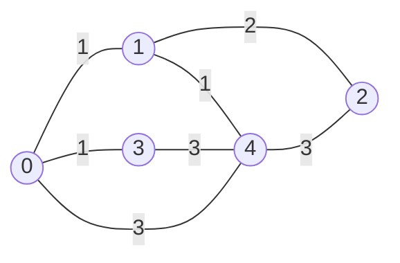

# Recorrido en profundidad (*DFS, Depth-First Search*)

El recorrido en profundidad es un algoritmo fundamental para explorar grafos. Partiendo de un nodo de origen, el algoritmo visita un nodo y luego se mueve inmediatamente a uno de sus vecinos no visitados, y desde ese vecino a otro, profundizando tanto como sea posible antes de retroceder. Cuando un nodo no tiene vecinos sin visitar, el algoritmo regresa al nodo desde el cual se llegó y continúa por otra rama. El resultado es una secuencia de visita que agota una rama completa del grafo antes de pasar a la siguiente.

El término inglés *depth-first search* (DFS) se traduce de dos maneras en la literatura: **búsqueda en profundidad** cuando el algoritmo tiene un objetivo, como encontrar un nodo o un camino, y **recorrido en profundidad** cuando el propósito es visitar todos los nodos alcanzables. La diferencia es de énfasis, no de mecanismo: el mismo algoritmo sirve para ambas cosas. En esta página usaremos **recorrido en profundidad**, porque el programa que presentamos visita el grafo completo desde un origen, sin buscar un nodo específico.

El recorrido en profundidad aparece en varios problemas clásicos. Se usa para **detectar ciclos** en grafos dirigidos, lo que a su vez permite decidir si un conjunto de dependencias puede resolverse en algún orden. También es la base del **ordenamiento topológico**, que se emplea en la planificación de tareas, en los sistemas de construcción de software y en la verificación de prerrequisitos. Finalmente, es el mecanismo subyacente en los algoritmos de **retroceso** (*backtracking*), como la resolución de laberintos, el problema de las ocho reinas o la búsqueda de soluciones en un espacio de restricciones.

## Concepto clave: profundizar antes de retroceder

La idea central del recorrido en profundidad es que, en cada nodo, el algoritmo elige un vecino no visitado y se mueve a él de inmediato, sin explorar los demás vecinos primero. Solo cuando el nodo actual no tiene vecinos sin visitar, el algoritmo retrocede al nodo anterior y continúa con el siguiente vecino de ese nodo. Este comportamiento es lo que distingue a DFS del **recorrido en anchura** (*BFS, Breadth-First Search*), que explora el grafo nivel por nivel: DFS agota una rama completa antes de considerar las alternativas.

La recursión implementa este comportamiento de forma natural: cada llamada representa un nodo y cada regreso representa el retroceso al nodo anterior, de modo que la pila de llamadas de Python mantiene implícitamente el camino desde el origen y no hace falta administrar una pila explícita. Esa es la diferencia esencial con BFS: DFS usa una pila (*stack*), mientras que BFS usa una cola (*queue*).

Para que el recorrido termine, es necesario registrar qué nodos ya se visitaron. Sin este registro, el algoritmo volvería a entrar a los nodos ya explorados y, en un grafo con ciclos, no terminaría nunca. En un grafo no dirigido el problema es inmediato: desde un nodo `v` se puede regresar al nodo `u` por la arista inversa que el módulo agrega automáticamente, de modo que sin un conjunto de visitados el recorrido rebotaría indefinidamente entre `u` y `v`. En un grafo dirigido el problema aparece cuando existe un ciclo. En ambos casos la solución es la misma: un conjunto `visited` que registra los nodos ya procesados y que se consulta antes de cada llamada recursiva.

## Explicación del programa

### 1. Importación del módulo

El programa comienza importando únicamente la clase `Graph` del módulo `graphs.py`:

```python
from graphs import Graph
```

Esta forma trae un solo nombre al programa, en lugar de todo el contenido del módulo. Basta con importar `Graph` porque es la única clase que el programa instancia directamente: los nodos y las aristas se crean y se manejan a través de los métodos del grafo.

La alternativa sería importar el módulo completo, pero eso obligaría a calificar cada uso con el nombre del módulo. La diferencia entre ambas formas es visible en cómo se instancia el grafo:

```python
# Opción A: from graphs import Graph
from graphs import Graph

g = Graph(5, undirected=True)          # nombre directo
```

```python
# Opción B: import graphs
import graphs

g = graphs.Graph(5, undirected=True)   # hay que calificar con graphs.
```

Con `from graphs import Graph`, el nombre queda disponible sin prefijo. La forma calificada solo es preferible en programas grandes con varios módulos, donde el prefijo aclara de dónde viene cada nombre; aquí no aporta nada.

Para que la importación funcione, `graphs.py` debe estar en el mismo directorio que el programa (o en una ruta incluida en `PYTHONPATH`). El módulo no ejecuta código al importarse, ya que solo define clases, de modo que la importación no produce efectos secundarios.


